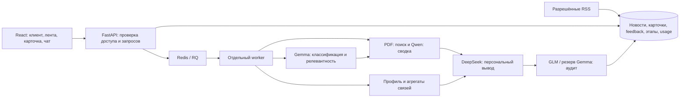

# Альфа Хак — персональная новостная аналитика

Работающий прототип: событие → профиль обезличенной компании → релевантность → аналитические PDF Альфа-Банка → персональный разбор рисков и возможностей → независимый аудит → сохранённая карточка → чат и обратная связь. Ошибка модели или отказ аудита не заменяются готовой карточкой.

## Комплект сдачи

- Репозиторий: https://github.com/olesiaivanova10-maker/alpha-goduton ; ветка `submission/hackathon`.
- Описание зафиксированной версии и результаты: [docs/SUBMISSION.md](docs/SUBMISSION.md).
- Проверка критериев и ограничений: [docs/COMPLIANCE.md](docs/COMPLIANCE.md).
- Сторонние компоненты, данные и смоделированные интеграции: [THIRD_PARTY_NOTICES.md](THIRD_PARTY_NOTICES.md).
- Тестовые компании создаёт `scripts/submission_init.py`; **их цифры вымышлены**, ID сохранены для совместимости интерфейса. Никаких готовых карточек этот скрипт не создаёт.

## Запуск для экспертов

Нужны Git, Docker Engine с Compose v2 (поддержка `env_file.required`), интернет для сборки и разрешённого API. Практический ориентир для лёгкого лексического режима: 2 vCPU / 4 GB RAM, запас диска 10 GB. GPU и скачивание весов LLM не нужны.

```sh
git clone --branch submission/hackathon https://github.com/olesiaivanova10-maker/alpha-goduton.git
cd alpha-goduton
cp .env.submission.example .env.submission
```

В `.env.submission` локально заполните `ALFA_HACK_API_KEY` ключом организаторов. URL уже задан. Ключ не нужен для просмотра профилей и пустой ленты, **но нужен для реального анализа и чата**. Без него анализ вернёт понятную ошибку, синтетического ответа модели не будет.

Положите предоставленные организаторами PDF и соответствующие OCR `.pages.json` в `data_alfbnk/`. Комплект PDF/OCR с контрольными суммами приложен отдельным архивом к версии сдачи; он не содержит ключей и реальных CSV. Без PDF интерфейс запустится, однако критерий использования аналитики банка проверить нельзя. Не подменяйте материалы банка учебным текстом.

Единый запуск всех необходимых компонентов:

```sh
docker compose -f compose.submission.yaml up --build -d
```

- Интерфейс: http://127.0.0.1:28080/ .
- API и Swagger: http://127.0.0.1:28081/docs . OpenAPI: `/openapi.json`.
- Журнал этапов и использования моделей: http://127.0.0.1:28080/api/developer .
- Остановка: `docker compose -f compose.submission.yaml down` (сохраняет данные).

Это **локальный проверочный режим**, доступен только на loopback, без входа и без тестового пароля. Нельзя публиковать его порт в интернет. Для общего стенда используются HTTPS и внешний контроль доступа; для промышленного контура — [PRODUCT_RUNBOOK](docs/PRODUCT_RUNBOOK.md) с PostgreSQL, миграциями, Redis/RQ, Qdrant и доверенной идентификацией. Публичный стенд и ветка сдачи могут иметь разные версии; зафиксированная версия проверяется локально.

## Сценарий проверки

1. На главной нажмите «Новостная аналитика». Выберите U_14366 и U_26030, сравните отрасль, продукты, ВЭД и платежные связи. В комплекте сдачи оба профиля явно отмечены как синтетические.
2. Нажмите «Сформировать живую ленту»: загружаются RSS и анализируются **до двух кандидатов**, а не весь архив. Либо откройте «Проверить новую новость» и вставьте собственный ранее не показанный текст. Не используйте конфиденциальные сведения: текст и обезличенные признаки отправляются в API организаторов.
3. Дождитесь завершения. Этап и причины отсева видны в `/api/developer` для выбранной компании/роли. HTTP 202 означает постановку задачи, а не успешную публикацию. Ноль карточек при отказе аудита — допустимый технический исход, но повод проверить качество модели/источников.
4. Повторите ту же новость для второго клиента. Сравните объяснения и основания; одинаковая новость не гарантирует разный вердикт, но вывод должен использовать разные признаки и не приписывать отсутствующие данные.
5. Откройте карточку: факт, важность клиенту, риски, возможности, возможное действие, выдержки банка, отдельная интерпретация ИИ, ссылки на PDF/страницы и признаки клиента.
6. Откройте чат, спросите о риске и неизвестном графике долга. Ответ должен признать отсутствие индивидуального договора. Перейдите к первоисточнику. Кнопка менеджера только копирует текст, в банк ничего не отправляет.
7. Поставьте оценку и комментарий. Перезапустите backend/worker и проверьте сохранение карточки и счётчика `/api/feedback/metrics`. Оценки не означают автоматического переобучения.
8. Используйте [test_cases/submission_scenarios.json](test_cases/submission_scenarios.json) как дополнительный набор разнородных **вымышленных** входов, затем проверьте собственные новости. Это сценарии проверки, не доказательство качества на неизвестной выборке.

## Архитектура и структура



`frontend/` — React/TypeScript. `backend/app/` — HTTP, загрузка CSV, профили/связи, RSS, задания, доступ, хранилище, журнал и model gateway. `agent/` — подключённая реализация моделей, промптов и PDF retrieval. Корневые файлы `adapter.py`, `orchestrator.py` и т.п. оставлены как совместимые импорты; приложение использует `agent/`. `backend/migrations/` — Alembic. `backend/tests/` — модульные/API тесты; `tests/integration/` — отдельный сценарий с реальными сервисами и фикстурными ответами моделей. `scripts/` — явные операции подготовки/оценки/импорта.

Комплект сдачи: SQLite в volume + Redis/RQ + backend + worker + frontend + однократная подготовка фикстур. Промышленная основа `compose.product.yaml`: PostgreSQL, Redis/RQ, worker, scheduler, Qdrant, backend и frontend. Лексический поиск работает без BGE; hybrid — отдельный необязательный режим с весами и собственными проверками. RAG разрешён условиями кейса, векторный метод не обязателен.

## Конфигурация и расходы

| Переменная | Назначение |
|---|---|
| `ALFA_HACK_API_BASE`, `ALFA_HACK_API_KEY` | Разрешённый API организаторов; только сервер |
| `DATA_DIR`, `PDF_DIR` | CSV и подлинные PDF/OCR |
| `PDF_REPORT_DATES_JSON` | Проверенные даты отчётов по именам файлов; неизвестные не выдумываются |
| `MODEL_DAILY_CALL_LIMIT` | Лимит обращений в данном стенде |
| `MODEL_DAILY_TOKEN_BUDGET` | Консервативный лимит резервирования выходных токенов, **не рубли и не полный input+output** |
| `MODEL_CONCURRENCY`, `MAX_QUEUE_SIZE` | Ограничение параллельности/очереди |
| `MODEL_PRICES_JSON` | Тарифы input/output за миллион токенов, в одной выбранной валюте; без тарифов стоимость `null` |
| `DATABASE_URL`, `REDIS_URL` | Постоянные данные и очередь; Compose задаёт внутренние адреса |
| `APP_ENV`, `REQUIRE_AUTH`, `ADMIN_API_KEY`, `GATEWAY_SIGNING_SECRET` | Режим и доступ; публичный прод закрыт без доверенной идентификации |

Разрешены только четыре текстовые модели из списка организаторов: `google/gemma-4-26b-a4b-it`, `qwen/qwen3.6-35b-a3b`, `deepseek/deepseek-v4.1-flash`, `z-ai/glm-5.3-flash`. Vision выключен. Провайдерный общий лимит **500 ₽/день** распространяется на команду; приложение не может гарантировать рублёвый остаток без тарифов и учёта остальных клиентов ключа. Перед длительной проверкой смотрите кабинет провайдера. В журнале видны реальные usage/ошибки/задержки, неизвестная стоимость не считается нулём.

При замене синтетических CSV на предоставленные данные используйте документированный product-режим либо отдельный override. Не смешивайте вымышленные профили и старые карточки: версии зависят от профиля, контента, промптов, моделей и PDF; несовместимые карточки скрываются.

## Тесты и воспроизводимость

Python 3.12 в `.python-version` и Docker digest; точные ключевые зависимости — `backend/requirements.txt`, полный контейнерный lock — `backend/requirements.lock`. Node 24 и `frontend/package-lock.json`; установка `npm ci`. Образы Compose закреплены digest.

```sh
python -m pip install -r backend/requirements.lock
APP_ENV=test PYTHONPATH=backend:. python -m unittest discover -s backend/tests -v
cd frontend
npm ci
npm run build
```

Локальная оценка retrieval: `PDF_DIR=data_alfbnk python scripts/evaluate_retrieval.py test_cases/retrieval_golden.json`. Короткие живые пробы — `python scripts/live_model_smoke.py` только при явно заданном ключе. Обычные тесты не тратят бюджет API. Интеграционные проверки и ограничения описаны в [PRODUCT_VERIFICATION](docs/PRODUCT_VERIFICATION.md).

## Безопасность, сопровождение, качество

В публичном контуре: HTTPS, доверенная идентификация с областью компаний, администраторские операции отдельно, защита карточек и job по компании, лимиты запросов/моделей, allowlist RSS и публичных адресов, запрет произвольных инструментов/переходов агента. Модели не получают ключи, ФИО или полные платёжные строки; передаются обезличенные признаки и агрегаты. Данные документов — недоверенный ввод; аудит не заменяет экспертную проверку.

Новые источники подключаются через allowlist/парсер, отрасли — через данные профиля и оценку на новой выборке. Метрики: доля ошибок/отказов аудита, доля публикации, время очереди/моделей, токены/стоимость, Recall@k и точность источников, полезность и доля оценок 4–5. Ежедневно просматривать ошибки/отказы и негативные оценки; перед изменением промптов эксперт размечает отдельную контрольную выборку, сравнивается персонализация минимум по двум компаниям. При регрессии откатываются образ/промпты/корпус, а не автоматически обучается модель на оценках. Резервные копии БД и восстановление обязательны для общего стенда.

**Ограничения:** качество неизвестных новостей и OCR требует независимой экспертной оценки. Это прототип для хакатона, не готовая банковская продукция; публичный OIDC, подтверждённые тарифы, юридические права на дальнейшее распространение материалов, нагрузочные SLO и эксплуатационные процессы не считаются завершёнными.
