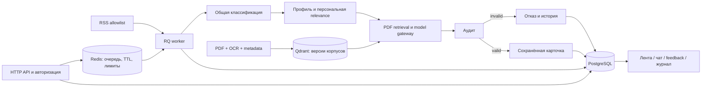

# Backend: фактическая архитектура и границы проверки

Обновлено: 26 октября 2026 года. Ветка: `backend/product-foundation`, создана от `main` после `7648caa`. Предыдущий документ описывал старый main; его исходный текст сохранён в истории Git. Последние исправления действующей демки перенесены отдельными коммитами без CSV/PDF/секретов. Сервер этой задачей не изменялся.

## Состав

```text
backend/app/
  main.py                HTTP-контракты и health
  settings.py            dev/test/prod, валидируемая конфигурация
  security.py            доверенная identity/scope-подпись, авторизация, rate limits
  storage/
    db.py                SQLAlchemy, транзакции, отсутствие SQLite fallback в prod
    models.py            новости, источники, инсайты, цитаты, feedback, jobs, история, probes, вызовы, корпуса
    repositories.py      общий доступ API и worker к данным
  jobs.py                Redis/RQ, SQL-задания, leases, retry и recovery
  scheduler.py           один активный планировщик RSS и recovery
  model_gateway.py       allowlist, timeout/retry, concurrency, circuit, budget, usage
  model_health.py        отдельные активные probes и чтение сохранённых результатов
  news_ingestion.py      allowlist RSS, ограниченный XML, дедупликация, сортировка
  news_store.py          PostgreSQL/SQLite как источник истины; Redis TTL=60 секунд
  classification.py      общая классификация отдельно от персональной relevance
  versions.py            fingerprints профиля, prompt/model config и корпуса
  live_feed.py           персональный анализ и управление публикацией аудитом
  news_journal.py        статусы и история по новости/компании/роли
  chat_service.py        общий доверенный контекст для обоих контрактов чата
  feedback.py            постоянный feedback только к доступному инсайту
  rag_service.py         версионированный BGE/Qdrant hybrid + reranker (опциональный режим)
agent/
  orchestrator.py         этапы анализа через общий model gateway
  rag/index_documents.py явный PDF/table/OCR индексатор
  rag/retriever.py        lexical fallback и адаптер hybrid
backend/migrations/       фиксированная Alembic-схема
scripts/                  импорт, smoke, provisioning, evaluation, profiling
compose.product.yaml      backend, worker, scheduler, migration, postgres, redis, qdrant, frontend
```



## Что изменено относительно исходного аудита main

| Область | Реализация в этой ветке | Граница |
|---|---|---|
| Данные | SQLAlchemy repositories, Alembic, PostgreSQL в prod; SQLite в dev/test | Старые файлы импортируются отдельно, без автоматического изменения серверной БД |
| Новости | Постоянный каталог, source health, provenance, candidate duplicate groups | RSS содержит преимущественно анонсы; это не полный обход всех статей |
| Лента | Только сохранённые аудированные результаты, точные IDs, версии зависимостей, пагинация | Массовая персональная обработка всех компаний не включается автоматически |
| Feedback | FK на инсайт, rating 1–5 в API и БД, company check | Обратная связь сама по себе не переобучает модели |
| Долгие операции | Redis/RQ worker, scheduler, leases/recovery, 202 + job_id | At-least-once; восстановление после падения может ждать окончания lease |
| Аудит | Невалидный ответ не даёт valid; rejected сохраняется, но не публикуется | Оценка модели не заменяет экспертную проверку |
| Чат | Оба endpoint получают сохранённый серверный контекст, sources и явный fallback | Старый контракт требует однозначного точного заголовка |
| Модели | Подтверждённые текстовые IDs, общий gateway, usage и лимиты, реальные probes | Тарифы не выдумываются: без конфигурации стоимость null |
| RAG | PDF pages/checksums, OCR confidence, таблицы при установленном extractor, версии корпусов, hybrid-код | Веса BGE/reranker не provisioned; качество hybrid не подтверждено |
| Доступ | Company/card/job checks, закрытый prod по умолчанию, HMAC seam к gateway | OIDC login/gateway ещё должен подключить оператор |
| Запуск | Compose и non-root app, закрытые сервисные порты, backup/restore инструкция | Это не отказоустойчивая банковская инфраструктура |

## Изменения HTTP-контрактов

- `/feed`, `/api/feed`, `/chat`, `/api/chat`, company context и feedback сохраняют прежние формы ответов; у чата добавлен `fallback`.
- `POST /api/insights/analyze` сохраняет форму запроса, но вместо синхронного ответа возвращает 202 + job_id. Клиент должен получать результат через job status и ленту. Это намеренное изменение, отражённое в runbook.
- `POST /api/news/refresh`, `/api/feed/refresh`, `/api/rag/index` — асинхронные задания.
- `/health/live`, `/health/ready`, `/health/models` разделены. GET моделей не инициирует платную проверку; административный force ставит задание с ограничением частоты.
- `/api/developer`, `/api/developer/news`, `/api/developer/news-history`, `/api/developer/usage` защищены административным доступом.

## Проверки и оставшиеся условия

Фактически выполненные проверки: [PRODUCT_VERIFICATION.md](PRODUCT_VERIFICATION.md). Запуск, identity gateway, migrations, импорт, backup/restore, rollback, модели и corpus activation: [PRODUCT_RUNBOOK.md](PRODUCT_RUNBOOK.md).

Не заявляем готовность к банковскому production. Остаются: подключение реального OIDC gateway, provision и проверка моделей BGE/reranker, экспертная разметка/качество retrieval, оценка ресурсов более тяжёлого стека, нагрузочные SLO, денежный billing/reconciliation, автоматизированные резервные копии/rollback и отдельная HA-инфраструктура. Vision отключён до подтверждения capability и реализации разрешённого пути обработки изображений.

## Первичные технические источники

- [SQLAlchemy transaction/session lifecycle](https://docs.sqlalchemy.org/en/20/orm/session_basics.html)
- [RQ worker scheduler](https://python-rq.org/docs/scheduling/)
- [BGE-M3 official model revision](https://huggingface.co/BAAI/bge-m3/tree/5617a9f61b028005a4858fdac845db406aefb181)
- [Sentence Transformers local-only model loading](https://sbert.net/docs/package_reference/cross_encoder/model.html)
